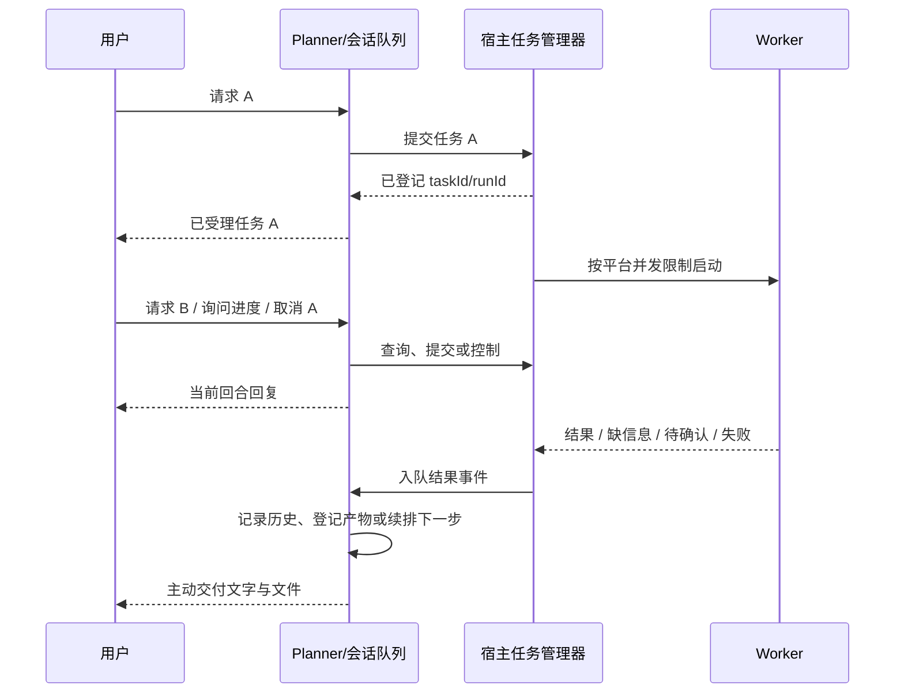

# 会话引用与后台任务交互方案

状态：**A 与 B 首版已实现，后台模式默认关闭，尚未生产验收**。设计日期：2026-10-23；实现对账：2026-10-24。§1–8 保留设计与验收目标，实际落地范围和差异以 §9 为准。

## 1. 决策与范围

两项功能分别实施、分别验收：

| 功能 | 用户得到的行为 | 第一版边界 |
|---|---|---|
| A：原生消息引用 | 用户在企微引用旧消息，Planner 能读到被引用内容与本次正文 | 支持文本、图文混排中的文字；其他引用只标记类型 |
| B：后台委派与任务控制 | Worker 执行时，Planner 仍可接受下一轮对话；任务结束主动交付结果与文件 | 单进程运行、Planner 回合串行、沿用平台并发限制；支持状态查询和取消 |

推荐顺序：先 A；再完成 B 的执行、交付、控制闭环后开启后台模式。B 的工程实现可以分波提交，未闭环时保持关闭。

沿用既有任务身份、计划、预算、通知送达、真实用户确认、执行审计和产物库。业务 operation、参数含义、成功与读回判定仍归执行层。新功能不向通用 runtime 添加业务判断分支。

本轮不建设分布式调度、跨进程任务认领、心跳租约、崩溃自动重跑、完整 DAG 引擎。运行中修改任务、暂停恢复属于后续波次；它们不能仅通过向 Worker 塞一条文本就声称完成。

## 2. 当前实现与改动起点

| 当前机制 | 代码锚点 | 改动含义 |
|---|---|---|
| 同会话整个 `processMessage` 串行 | `apps/server/handler.ts`：`sessionQueues` | 保持 Planner 与会话结果写入串行；让 Worker 生命周期脱离当前请求 |
| Planner 等待 `platformTask.run()`；单步终稿经 terminate 直接外发 | `packages/agent/src/runtime.ts`：delegate 分支；`pi-driver.ts`：`toAgentTool` | 后台提交返回宿主受理回执；最终结果由独立事件交付 |
| Worker 内部分配 taskId，支持 workerMessages 恢复 | `packages/agent/src/context.ts`：`createContextTaskRunner` | 抽出宿主准备步骤，提交时就拿到真实任务句柄 |
| Worker 继承当前调用的 signal、onStep、onNotice | `context.ts`；`driver.ts`：`TurnDriverInput` | 后台任务拥有独立取消信号、deadline 和发送通道 |
| 平台并发限制缺省为 1，等待者为进程内 FIFO | `context.ts`：`acquirePlatformSlot` | 保留限制，增加等待取消及真正启动前复核 |
| 计划步骤事实与任务结果已持久化，但没有后台运行状态 | `contracts/src/store.ts`：`TaskPlanRepo`、`PlatformTaskRepo` | 增加通用任务运行记录；不把 legacy outcome 当作运行状态机 |
| 通知回调依赖原消息流；sendMessage 只用于终帧降级 | `packages/channel-wecom/src/adapter.ts`：`notice`、`reply` | 新增可等待、独立于入站流的文字与文件主动交付 |
| 产物 ref 通过读取 max 再加一分配，依赖会话串行 | `apps/server/artifact-store.ts`：`ingestArtifacts` | 后台产物入库也进入同会话串行队列 |
| 原生 quote 未读取、通用入站契约无引用字段 | `adapter.ts`：`textOf`；`contracts/src/channel.ts` | 在渠道归一化处补引用，在 runtime 中单独组装 |

`docs/change-safety.md` 的实施纪律继续适用。本文不冻结当前脏工作树的测试数量，也不把此前文档中的通过数字当作本次验证结果。

## 3. A：原生引用消息接入

### 3.1 企微协议事实

官方 SDK 的 `BaseMessage.quote` 随当前消息下发，引用内容有自己的 `msgtype` 与内容字段。文本示意如下，省略其他回调字段：

```json
{
  "msgid": "本次入站消息ID",
  "msgtype": "text",
  "text": { "content": "解释一下这段" },
  "quote": {
    "msgtype": "text",
    "text": { "content": "此前的某段回复" }
  }
}
```

引用没有独立订阅事件，仍按外层消息类型交付。当前官方 SDK 声明与本地安装的 1.0.7 均未在 `QuoteContent` 中声明被引用消息的原始 msgid、作者或 taskId；不能从本次 `msgid` 推造旧消息身份。本文按实际收到的引用内容提供上下文，不承诺它就是完整原文。

依据：[官方消息类型](https://github.com/WecomTeam/aibot-node-sdk/blob/main/src/types/message.ts)、[官方消息分发](https://github.com/WecomTeam/aibot-node-sdk/blob/main/src/message-handler.ts)。

### 3.2 通用入站结构

建议在 contracts 中增加如下可选类型，名称在实现时统一；不引入 SDK 类型：

```ts
interface IncomingMessageReference {
  kind: 'text' | 'mixed' | 'image' | 'voice' | 'file';
  text?: string;
  truncated?: boolean;
  sourceMessageId?: string; // 仅渠道实际给出时使用；企微当前不填
}

interface TurnInputContext {
  messageReference?: IncomingMessageReference;
}
```

- `IncomingChannelMessage` 增加可选 `messageReference`；`text` 继续表示本次正文。
- `AgentRuntime.handleTurn(ctx, userMessage, inputContext?)` 增加可选第三参数；原有两参数调用保持兼容。引用内容不放入可信身份字段。
- 渠道负责提取，runtime 负责把引用与正文组装给 Planner。不要在 handler 中先拼成字符串再拿同一字符串做确认、授权、重复请求等判据。
- 引用为空的调用保持现有上下文与执行路径，避免为了单个渠道能力全面重写入站接口。

### 3.3 抽取与上下文规则

| 引用类型 | 第一版处理 |
|---|---|
| text | 取 `quote.text.content` |
| mixed | 按原顺序拼接其中 text 项；保留存在非文本内容的类型信息 |
| image / voice / file | 保留类型，告知暂未读取引用中的媒体；不自动下载或当成当前附件 |

引用文本按 UTF-8 字节限额截断并带 `truncated`。新增独立的 `MAX_QUOTED_TEXT_BYTES`，以当前上下文预算和长引用回归冻结值，不能把出站 `MAX_REPLY_BYTES` 当成入站约束。runtime 仍受已有上下文预算约束，不能无标记丢弃引用。临时 URL、aeskey 和原始回调帧不进入模型或检索历史。

模型输入用宿主生成的数据块明确呈现“本次正文”和“用户引用内容”。字段内容经结构化编码，不能靠用户可伪造的分隔符判断来源。

引用可用于理解指代与实体来源，不代表历史数据仍有效，也不代表用户本轮授权执行引用里的指令。计划确认仍只匹配本次正文；引用里的“确认 X”“取消 X”不得触发操作。正文只有 `1111` 时，Planner 可以看到引用，但仍需询问具体需求。

计划实体来源增加独立的 `quotedEvidence` 来源，由宿主从本条引用注入；它只证明本轮收到的引用文本中出现了这个实体，不证明历史原消息身份或内容真实性。不要将引用替换成 `currentMessage`，不要据此写成“用户以前已确认过该实体”。范围来源检查仍只证明来源，不声称完成语义充分性判断。

### 3.4 持久化与重复请求

引用随本次 user event 以可选结构化 metadata 保存。`ConversationEventRecord.content` 保持本次正文，增加 `messageReference` 对应的可空 JSON 列；搜索显式查询引用 JSON 中的文本，并在 `search_history/get_messages` 输出时分别呈现正文与引用。不要为了让引用可检索而把它拼进 content，Context State、长期记忆提取仍只把正文视为当前用户的直接陈述。

SQLite 同时处理新库和已有库：新库声明可空列；已有库按项目现有 `PRAGMA table_info + ALTER TABLE` 方式补列；NULL 读回按无引用处理。`sameConversationEvent` 的幂等比较须包含规范化引用 metadata；相同 eventId 的不同引用内容不能静默吞掉。

紧凑 Pi 转录保存带来源标记的引用数据，以便后续压缩和回溯。runtime 统一构造当前 user message 及宿主持有的 `hostContext: { messageReference?, requestKey? }` 伴随元数据；普通返回、direct reply、确认、确认恢复、失败兜底等所有持久化路径共用该构造，避免某一提前返回分支丢引用。实现前表征 SDK 序列化/恢复是否保留该元数据；若 SDK 会剥离，改为宿主持久化的伴随映射，不能假定 Conversation Log 的字段会自动出现在 `loaded` Pi 转录里。

`findRepeatedDelegatedRequest` 同时读取历史 user message 的宿主元数据和当前引用信息。正文、引用只归属于本次入站事件，不能伪造一条“历史原始消息”。

需区分两种去重：

- 渠道入站排重继续按本次 messageId，不因引用相同而丢新消息。
- 实时重复请求复核使用正文及其引用上下文的稳定键。正文继续使用现有 `normalizeUserRequest`；引用按固定字段顺序编码 kind、规范化 text、truncated，以及渠道实际提供的 sourceMessageId，不包含本次 messageId、临时 URL 或到达时间。无引用时沿用现有判据。同一句“查这个”引用 A 与引用 B，不能机械认定为同一个请求。

引用字段不参加确认码正文匹配。旧转录没有引用 metadata 时保留既有兼容行为，不反向猜测旧记录的引用关系。

### 3.5 A 的验收

1. 截图场景：Planner 同时看到正文 `1111` 与被引用文字，回复澄清而非声称未收到任何上下文。
2. 普通消息无行为变化；正文“确认 X”仍正常；仅引用含确认码或取消码不触发操作。
3. text/mixed 顺序正确；引用媒体不把 URL、密钥或文件自动纳入本轮输入。
4. 同正文、不同引用不会误用重复请求的历史依据；同一完整请求再次发送仍走现有实时重查规则。
5. 引用进入转录与历史检索；压缩后保留引用归属，引用文本不自动成为用户已确认事实。
6. 长引用显式截断；无原始 msgid 时不编造历史事件或任务绑定。

## 4. B：后台 Worker 与 Planner 多轮交互

### 4.1 执行方式

这是后台委派：Worker 继续运行，Planner 结束当前回合并接待新消息。第一版不把用户消息直接 steer 到 Worker，也不让同一会话同时运行两个 Planner。



后台开关由宿主部署配置决定，例如 `interaction.workerDispatchMode: inline | background`，缺省 inline。首版不让模型按“看起来耗时”判断后台与否；开启后 delegate 走后台，`route_current_turn` 现有 kind/request/continueTaskId 形状保持不变。task_control 为独立的宿主工具。

### 4.2 模块职责与最小接口

| 位置 | 职责 |
|---|---|
| `packages/contracts` | 引用输入、通用任务快照/事件、任务查询控制接口、渠道主动发送契约 |
| `packages/agent` 新 `task-manager.ts` | 进程内调度、独立 AbortController、运行状态转换、有限等待队列和任务控制 |
| `context.ts` / Worker driver | 准备与执行分离，复用现有 taskId、workerMessages、目录、计划门与执行凭证 |
| `packages/core` | 任务运行记录、结果事件与交付状态的追加式持久化；没有后台 claim/lease 调度器 |
| `apps/server` | 同会话事件串行、产物入库、完成通知、组装当前任务清单 |
| `packages/channel-wecom` | quote 归一化；主动文字及媒体发送；传输错误返回宿主 |

接口示意，属于宿主内 API，不直接暴露身份与路由参数给模型：

```ts
interface TaskManager {
  submit(input: PreparedTaskRun): Promise<TaskReceipt>;
  list(scope: TaskScope): Promise<TaskSnapshot[]>;
  get(scope: TaskScope, taskId: string): Promise<TaskSnapshot>;
  cancel(scope: TaskScope, taskId: string): Promise<TaskControlReceipt>;
  shutdown(): Promise<void>;
}
```

`PreparedTaskRun` 在启动前由宿主准备；原来在 `context.run` 内生成 taskId 的逻辑抽出来复用。真正登记成功才返回受理回执，禁止先说“已开始”后才发现任务没创建。排队时明确说排队，不把获准、启动、完成混为同一状态。

每次提交使用宿主持有的 dispatchKey：用户提交绑定原入站请求与工具调用身份，自动续步绑定 resultEventId 和目标步骤。同一 dispatchKey 只能创建一次 run，并返回同一回执。登记 run、登记来源事件消费结果使用短事务/唯一键；事务中不能等待模型、Worker 或渠道网络请求。

### 4.3 任务、运行与输入快照

复用 taskId 表示可续跑的 Worker 任务；新增 runId 表示每次 Worker 调用。多步计划与补充信息续跑继续使用原 taskId，不重置执行层累计账本。planId 保留为既有多步计划关联，不由模型伪造。

新增轻量任务运行持久化，至少保存：

- taskId/runId、originRequestId、originUserEventId、principalId、sessionId、planId/step 信息、创建顺序及时间；
- 原始用户请求与宿主加工请求的引用、实体来源快照、输入文件清单、任务工作区、原始交付路由；
- queued/running 等状态、最后一条宿主进度事实、起止时间、取消原因、deadline、结果及产物引用；
- result event、会话记录状态、推送各部分的交付状态，以及该任务创建时的 dispatchMode。

查询快照同时返回逻辑任务状态、最近/活动 runId 及其状态、起止时间、最近进度与交付状态；不能用一个“处理中”掩盖已完成待交付、确认后新 run 或中断的旧 run。

AbortController、活跃 Promise 与等待队列只存内存；身份、输入和结果可持久化。凭据和函数回调不落库、不进入模型参数。

附件在任务受理时冻结交付集，后续消息的新文件属于后续任务；等待排队不能重新扫描会话附件池改变任务 A 的输入。运行与排队中的输入文件、产物暂存由任务引用保护，GC 不得按旧的 `outcome=done` 提前删除。

同一 taskId 最多一个活动 run，防止两轮同时恢复同一份 workerMessages 或操作同一个 scratch。独立任务使用各自 taskId 和目录。Planner 新请求 B 不得改写任务 A 的来源快照、确认状态或输入集。

首版继续使用既有 `tmp/<taskId>` 工作区，不改成 run 级目录，以保留提案路径及续跑兼容。每个 run 保存启动前的文件清单与输入的路径、大小、摘要，以及结束后的输出清单；按明确输出声明或文件变化归因到 run。既有文件复用原 artifactRef，不能仅凭 mtime 把旧产物重新算成本轮新结果。输入需要在受理时复制/固定到任务可读位置并校验摘要，不能只保留之后可能被覆盖或 GC 的会话路径。

### 4.4 状态与取消语义

```text
queued -> running -> completed | failed | waiting_input | waiting_confirmation
queued -> cancelled
running -> cancelling -> cancelled | completed | failed
waiting_input / waiting_confirmation -> queued（用户补充或真实确认后的新 run）
queued / running / cancelling -> interrupted（进程退出或重启发现遗留记录）
```

逻辑任务和单次 run 分开记账：多步计划的某个 run 结束，不等于整项任务结束。完成还需按当前计划事实推进或收口。`completed` 只表示按现有结果契约收到了交付结果；执行层的成功、失败、读回验证状态单独保存。不得把当前 legacy `outcome=done`、一次 bash 放行或 task 受理回执升级成“业务校验通过”的证据。

取消采用宿主状态转换并发送 AbortSignal：

- 排队任务：立即移除等待者；必须保证以后不会取得槽位再启动。
- 运行任务：先返回“已请求取消”；等待驱动结束与子进程清理后再报实际结果。取消与完成竞态由同一个终态转换判据裁决。
- 已完成或失败：返回实际状态，不宣称已撤销操作。
- 待确认任务：按现有取消/过期机制处理对应计划或提案，不假装有一个仍在运行的 Worker。

AbortSignal 是否中止正在运行的 shell 子进程必须单独表征；在确认子进程已退出前，不能释放平台槽位并启动下一任务。无法证实退出时保留“取消处理中/状态待核实”，不给成功取消回执。已发生的外部操作不做自动回滚。

`acquirePlatformSlot` 改成支持 signal 的可移除等待项；排队耗时、Worker 运行时限分别记录。Worker deadline 在真正启动时按既有 workerTimeoutMs 计算；逻辑任务累计预算仍沿用现有任务账本。等待队列必须有部署容量上限，灰度前依据既有任务时长与负载确定，超限给明确反馈。

### 4.5 Planner 与会话写入

保留同一会话串行队列，并扩展为 `user_turn | task_event` 两种入口：

1. 用户回合只等待 Planner 和宿主登记/控制操作，不等待后台 Worker 完成。`turnState` 保存 `backgroundStarted + taskId/runId`，用宿主受理文本及 terminate 结束本回合，`decideTurnExit` 增加受理专用分支；不能把它当作本轮已取得执行结果。多步计划提交第一步后同样立即结束 Planner 回合，不能让它拿受理回执继续派第二步。
2. Worker 只更新自己的任务记录、转录和结果事件；不能从回调中直接覆盖共享的 Planner 转录。
3. 完成事件进入同一会话队列，按队列顺序记录可检索结果、分配产物 ref、更新会话投影并发送。当前 Planner 回合结束前不并发修改这份转录。
4. 事件使用 `task_event` 类型和稳定 eventId；不伪装成用户发来一条“继续”，不继承会话中最近另一位用户的身份。
5. 状态查询直接读取任务记录，即使完成事件尚在排队，也能显示最新状态。后续 Planner 每轮加载该会话可见的活动/待输入/近期完成任务清单；历史较久的结果走既有历史检索。

多步计划继续复用既有拆解协议：Worker 一步结束后，宿主给原 planId 入队一次 continuation 事件，Planner 根据**该计划的原始请求、已执行结果与实体来源**决定下一步。不能把此时最新的无关问题 B 当成计划 A 的继续授权；旧事件重复消费不能重复派出同一步。

提供独立内部入口，例如 `resumePlanFromTaskEvent({planId, taskId, stepIndex, originUserEventId, originalRequestSnapshot, resultEventId})`，分配新的内部 requestId。不得简单重调 `handleTurn(ctx, latestUserMessage)`。事件消费状态与派单键显式保存，重复消费只能返回已有派单结果。

`task_event` 同时落到 contracts 的事件类型、Conversation Log 读写、Context State reducer、历史工具和主动回溯的渲染规则；记录 taskId/runId、来源请求和结构化 outcome，不从散文猜状态。会话结果消费游标/事件处理状态标记实际入转录，不因一次临时上下文注入就删结果或标记已经推送。旧客户端遇到未知事件不崩溃，已存在的事件默认按旧路径处理。

单步结果保持现有 Worker 终稿出口规则，不强制再调用一次模型改写。多步汇总或缺信息回路可以唤醒 Planner，但须带原 taskId/planId 和明确触发类型；每次续跑保持既有 needs/零执行/计划提交上限。未完成计划不能因前台回合提前返回就被标记完成。

### 4.6 主动通知、文件与历史

新增通用渠道能力，例如 `sendToConversation(route, reply): Promise<DeliveryReceipt>`，支持文字与 `files[]`。route 由宿主保存并验证，Worker/模型不能选择任意会话地址。

企微文字使用 `client.sendMessage(chatid, markdown)`；文件使用 `uploadMedia` 后 `sendMediaMessage(chatid, 'file', mediaId)`。本地 SDK 1.0.7 已声明此能力，当前项目的 `SdkClientLike` 增加所用主动媒体方法，文件逐个记交付回执。禁止后台继续持有原 frame、req_id、streamId 或 `replyMedia(frame, ...)` 来假装当前回复仍在进行。

原入站流在任务登记后立即以“已受理/排队”发送 `finish=true`；不能只发 progress 后让原流一直显示处理中。最终结果及文件均是新的主动消息，不依赖原被动回复有效期。

交付顺序：

```text
Worker 返回并保存 run 结果
 -> 创建稳定 result event，并释放 Worker 占用的平台资源
 -> 同会话队列内：按 task/run 收集产物、复制入库、登记历史与关联
 -> 主动发送文字及各文件
 -> 逐部分记录平台 ACK / 失败 / 结果未知
```

产物收集严格限定到该 task/run 的输入快照与输出目录；不能沿用“扫描本会话全部任务目录 + 时间阈值”收后台产物，否则 A 的交付可能捎上 B 的文件。入库、分配 ref 与事件消费同会话串行；尚未入库的结果工作区不得被 GC 清除。

结果记录、用户可检索历史与推送回执分别记账：`recorded` 不代表 `sent`，`sent` 只代表渠道 ACK，不代表用户已读。推送失败时结果与产物仍可查询/重发，不重新运行 Worker。

任务结果写库失败时保留内存结果与工作区，记录可关联 task/run 的登记失败并有限重试写入，不能为补记录重新执行平台操作，也不能把已发送结果谎报为已入历史。重试耗尽时给可行动的登记/交付失败反馈，任务清理不得删除待核对产物。

发送前登记 delivery item；文字和每个文件使用稳定 itemId，记录 pending/sending/sent/failed/unknown。明确失败可按既有有界策略有限重试；请求可能成功而 ACK/本地记账失败的形态标记 unknown，第一版不盲目无限重发。不承诺网络故障下 exactly-once。

首版交付必须覆盖文字和生成的文件；工程骨架阶段可先联通文本，但不能在用户需要表格交付时把“文本通知 + 用户再追问重发”当作完整上线验收。

计划通知 `onNotice` 也接新的主动发送通道：需要通知才能激活的计划仍须等待发送 ACK；发送失败不能激活。普通进度从放行事实生成并节流，第一版状态查询可读最近进度，不逐条推送工具日志。

计划通知与待确认结果共用 `taskId + planId + version + noticeKind` 的交付身份；若 Worker 在 onNotice 已送达确认摘要，随后 pendingPlan 结果事件不再重复推送同一份摘要。去重按结构化身份与回执，不按消息文本相似度。

### 4.7 任务控制与确认

Planner 增加 `task_control({action, taskId?, ...})`，第一批 action 为 list/status/cancel。身份与会话范围由宿主注入，不能由模型指定。工具仍遵守现有回合申报义务；返回事实，用户状态文案由宿主渲染。

排队优先级调整在 B3 后续小波提供：只移动尚未开始的任务，不抢占已运行 Worker。运行中补充指令和暂停恢复后做；若要变更正在执行的范围，走明确取消、保留已发生事实、重新派单或既有续跑与重计划流程。

群聊沿用当前共享会话；查询结果和控制权限仍按既有任务 principal 绑定。首版不新增管理员/成员权限体系，也不因共享 conversationId 或 quote 而允许另一位用户控制该任务。多个候选时询问用户，不能按“最近的 taskId”静默取消。

预算计划确认与写提案确认分别复用现有状态机，不合并语义：

- 后台遇到等待确认时，Worker 结束本 run，任务进入 waiting_confirmation，并主动送达原有摘要与确认要求。
- 用户正文确认仍在宿主匹配；确认后提交该任务的新后台 run，不能再次同步等待 Worker 堵住会话。
- host commit 也进入共享的平台执行槽位；具体提交命令与读回仍由执行层适配器负责。
- 排队到真正执行前，重新复核计划版本、有效期与已有确认状态；不要在长队列等待期间占用一个会过期的确认 claim/lease。
- superseded 的范围限定为同一任务/计划的旧版本；独立任务 B 不能顺带使任务 A 的待确认条目失效。现有逻辑若按会话 supersede，须在该波兼容改造并冻结旧待确认数据行为。

具体接线：把 `context.ts` 工厂内私有并发闸抽成共享 `PlatformExecutionGate`，同一个实例传给 Worker 和 host commit。handler 的确认恢复分支改为提交后台 resume；`matchConfirmation` 中的提案 commit 拆为“宿主匹配/接受裁决”与“后台 host operation 执行”。原确认消息只等待裁决和任务登记，立即 finish，执行结果仍由完成事件收口。提交前过期或 superseded 时返回实际状态，不继续执行旧裁决。

### 4.8 进程退出与运行边界

后台任务与当前 HTTP/企微入站请求断开、Planner deadline 分离；一个前台回合结束不应 abort Worker。用户取消与服务停机由任务管理器自己的 controller 控制。

优雅停机顺序：停止接受新委派，取消排队项、对在途 Worker 请求中止，有限等待结果落盘和通知处理，最后关闭渠道与数据库。进程异常退出后，启动时把遗留 queued/running/cancelling 记录标记 interrupted；不自动执行，不把原活动 Promise 假装仍存在。

启动收口只处理新增后台 run 表且保持幂等，不扫描 legacy `platform_tasks.status='active'` 判存活；先完成遗留状态收口，再开始 scratch GC。interrupted 仍能查询、人工核对或按显式请求续跑，不触发任何自动重新派单。

waiting_input/waiting_confirmation 与已完成结果仍可查询，并按原有用户续跑/确认机制处理。重启后推送结果未知的条目不自动重放；下次查询明确展示交付状态，支持手动重发。任务管理器不实现后台恢复调度。

## 5. A 与 B 的结合：引用控制任务

后台受理、状态和交付消息统一带宿主生成的可读标签，例如“任务 3 · 汇总报表”。会话内任务序号由宿主分配，映射到 taskId；与产物 `#ref` 区分展示。

用户引用某条通知说“取消这个”时：

1. 解析实际引用中存在的宿主任务标签，在当前会话任务表中查映射，并按当前 principal 校验控制范围。
2. 仅一个合法任务时调用控制接口；多个、没有标签或标签无效时，结合任务清单询问用户选择。
3. 不凭文本相似度或内容哈希宣布“引用必定对应任务 X”；引用缺少原始 msgid 的限制仍存在。

任务 A 的完成结果在交付时关联 taskId/runId、结果 eventId 和 artifactRefs。用户引用结果要求解释、引用文件通知要求重发，可从该映射读取；不能用 quote 文字作为平台实时查询结果或执行成功凭证。

## 6. 实施波次与验收

| 波次 | 内容 | 必须通过的验收 |
|---|---|---|
| A0 | 原生 quote 回调表征、契约、规范化 | 无引用行为不变；文本/混排/媒体/截断符合 §3 |
| A1 | runtime 输入与持久化、检索、重复请求兼容 | 正文确认独立；不同引用上下文不混淆；引用可回溯 |
| B0 | 冻结同步 delegate、needs、多步、确认、取消、产物交付基线 | 保留当前行为；新增代码默认关闭 |
| B1 | 任务准备与运行分离、任务/run 记录、进程内 manager、可取消等待 | Worker 未完成时原入站流已 finish、下一问可进入 Planner；平台并发仍受限；排队取消后绝不启动 |
| B2 | 独立主动发送、结果事件、产物、历史、状态控制 | 完成/失败/缺信息/取消都交付；文字及多文件；结果在后续对话中可见 |
| B3 | 真实确认续跑、needs 与多步 continuation、停机/回滚 | 确认后不阻塞会话；预算跨步保留；旧任务兼容；无重复派单或伪终态 |
| B4 | 开后台灰度；再单独增加排队顺序调整 | 不扩展平台并发；明确展示排队/执行；满足下列交叉场景 |

核心交叉场景：

1. A 的 Worker 阻塞未完成，用户提出普通问题 B，B 正常回复；随后 A 的结果单独送达。
2. A 运行时提交任务 B：B 明确排队；取消 B 后 A 结束也不会启动 B。
3. 取消 A 与 A 完成同时发生：只记一个真实终态，释放一次槽位，不发送互相矛盾的两条结果。
4. A 完成时 Planner 正在处理 B：结果事件排队，不覆盖 B 的转录；后续引用 A 的结果仍可定位。
5. A/B 各有文件：交付各自文件，产物 ref 不重复，GC 不删除运行中或待入库文件。
6. 完成通知文字成功而某文件失败：只重发失败文件，任务不重跑；历史明确区分生成与交付状态。
7. 后台触发 notify：ACK 前不激活；通知失败无执行；后台确认与提案 commit 沿用原有真实确认和复核。
8. 多步 A 的第一步结束期间用户发起 B：A 的续步仍绑定原请求/planId，B 不成为 A 的补充授权。
9. 重复 completion event、取消、确认消息均不重复提交同一 run；进程重启不自动重跑旧任务。
10. 群聊其他成员的新问题不改变运行任务身份；无授权的任务控制被拒绝或引导联系发起人。
11. 开关关闭、无引用和 legacy 待确认任务仍通过既有黄金行为；后台受理回执不会放开数据结果出口。
12. 服务退出、任务写库失败、推送失败、事件处理失败都有可关联 task/run/request 的记录和可行动反馈。
13. 关闭后台新任务入口后，已有任务仍可收口和交付；执行 drain/取消再回退代码，不留下无人处理的活跃 Worker。

按 `docs/change-safety.md` 执行表征先行、基线冻结、变异验证；所有执行层联调只使用 mock。关键变异包括：移除会话队列、复用前台 signal/notice、忽略排队 abort、重复消费 continuation、正文与 quote 混合确认、扫描全会话产物目录、ACK 前激活、后台 receipt 伪造 execution。每种应让对应验收失败。

修改输入组装、route 描述或 Planner 提示词的波次须保存改前/改后真实模型探针（仍使用 mock 执行器）；判据先写死，不凭回复语气好坏判断通过。渠道真实环境只做经授权的引用和主动消息/文件验收，不切真实业务执行模式。

## 7. 开关、迁移与回滚

- A 随渠道解析生效；B 由独立部署开关控制，无引用与 inline 委派保持原行为。新 schema/字段只做向后兼容添加。
- B 的模式在任务受理时冻结。切回 inline 只影响新任务；已有后台任务继续提供查询、取消、确认续跑和结果交付，不能把它们丢到没有收口者的状态。
- 回滚前先停止接收新后台任务、等待结束或显式取消在途任务；再回退代码。不得只回退入口而保留无人处理的 Worker。历史任务/结果/产物表保留。
- 旧任务没有新运行记录时，按现有 inline/legacy 规则读取，不从 legacy `status='active'` 推断任务仍在运行。旧无 proposalId 写提案仍按既有过期规则，不借本波恢复。
- 实现完成同批更新 `v0-architecture.md` §10、`change-safety.md`、相关债务与回归判据；本文仍按已实现/待实施明确分界。已存在的非网关 shell 放行、执行痕迹与成功验收差距不在本波声称解决。

## 8. 上线可交付口径

A 完成后：企微原生引用内容可进入 Planner，并随历史可检索；本次正文仍保持独立语义。

B 完成后：用户可以在任务运行中继续对话、查询或取消任务；结果和文件主动交付并能被后续 Planner 读取；同一会话 Planner 串行，Worker 后台运行；平台执行并发不由宿主限制（2026-11-10 仲裁后归执行层自己的限流/熔断）。

设计提交阶段只完成代码路径核对；后续实现与验证记录见下节。尚未部署、重启服务或发送真实企微消息。

## 9. 首版实现对账（2026-10-24）

| 能力 | 实际实现 |
|---|---|
| 原生引用 | `channel-wecom/src/quote.ts` 归一化；文本与 mixed 文字按 UTF-8 上限 16,384 字节截断；媒体只保留类型，不伪造旧 msgid |
| 输入与历史 | 正文和引用分离；确认只读正文；引用单独存储、可检索，参与重复请求 fingerprint，实体来源为 `quotedEvidence` |
| 后台开关 | `FSHINE_WORKER_DISPATCH_MODE=background`；缺省或 `inline` 保留同步委派。引用没有单独部署开关 |
| 调度与输入 | `task-manager.ts` 管理进程内 run；SQLite 记录状态与 revision CAS；共享平台准入闸不限制并发、不设等待队列，`FSHINE_PLATFORM_QUEUE_CAPACITY`（默认 100）只作宿主待办深度背压（2026-11-10 仲裁后并发容忍/退避归执行层）；受理时冻结附件字节与 SHA-256 |
| 交互与控制 | 受理后终结原入站流；同会话 Planner 与完成事件串行；`task_control` 支持 list/status/cancel，身份与会话由宿主注入 |
| 确认与续步 | 预算确认和宿主提案确认沿用现有门禁；后台任务续跑绑定原 task/plan/request/quote，独立于最新无关提问 |
| 结果与文件 | 独立主动推送文字及文件；按 run 输出 manifest 收集，产物关联 `sourceRunId`；逐项保存 ACK/失败/未知，不因交付失败重跑 Worker |
| 运行退出 | 停止接收、取消并排干后关闭渠道与库；重启把遗留活动 run 标为 interrupted，不自动重跑或重放交付 |

实现与原设计的边界：

- 没有运行中 steer、暂停恢复、队列重排、跨进程调度；用户经 Planner 查询或取消任务后再发起任务。
- 显式取消尚未开始的提案提交时，宿主先阻止启动并作废待确认状态，再记取消。服务停机只将这种尚未开始的提交标为 interrupted，不代替用户撤销提案确认；恢复后可重新确认。已发生的提交不声称回滚。
- 引用表示本次收到的上下文，不证明旧消息身份、历史真实性或当前授权。压缩时宿主额外保存 sidecar：最多 128 个委派请求键计数、8 条引用出处，总计不超过 32,768 UTF-8 字节，正文预览每条最多 512 字节；保留尾部不重复计数，多次压缩合并原 sidecar。超限引用明确提示走持久历史检索，不能把模型摘要当成原文或用户授权。
- 已送达的确认通知按同 run 内宿主 notice 回执与精确文本去重；尚未实现设计中的 `planId + version + noticeKind` 通用交付身份。
- 交付失败保存可核对状态，不自动盲重发；现有产物重发能力可复用，不承诺任意失败部分的一键恢复或 exactly-once。（2026-10-25 修复波增补：显式传输失败有 3 次 × 750ms 有界重试，耗尽后向用户发可行动失败通知；启动期清扫终态未决投递——产物可校验则重投，否则标 failed 并通知。）
- 原生企微引用、真实主动消息/文件、真实模型表现尚未验收。真实模型探针被自动审批拒绝（读取真实配置并外发提示词及产生费用），等待明确授权；本地 mock 检查不受影响。

本地最终验证：完整 mock **1706/1706，129 文件通过**，typecheck 与 diff-check 通过（冻结基线 1582 项）。验证账本见 `change-safety.md` §18。回退入口时设为 `inline`；回退代码前先等待现有后台任务收口或显式取消并排干。新表与字段保留，不删除历史结果。

2026-10-25 review 修复波后的终态：完整 mock **1725/1725、129 文件**，typecheck 0 错误（账目见 `change-safety.md` §19）。该波补齐：确认闸等待上界 10s（超时 confirm_held、提案保持 pending）、后台多步计划零执行熔断（计数持久化在计划投影）、同 taskId 并发提交原子预留、后台受理回执落转录（repeat-request 复核在后台模式生效）、`task_runs.result_handling_state` 显式列（弃 metadata JSON 嗅探）、启动期投递清扫与传输失败有界重试、重发读回 sha256+size 复验。
